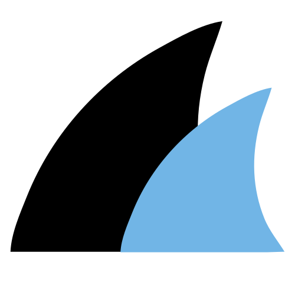
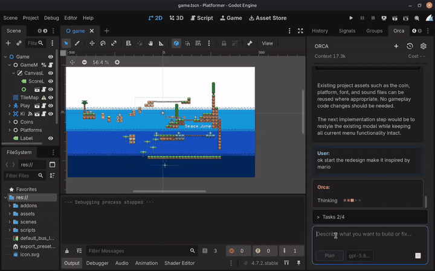

# Orca

**The open-source AI development agent that feels at home in Godot.**

Inspect your project, understand editor context, propose Godot-aware changes, and run focused development workflows without giving up control of your files.

  
  
  

<a href="https://github.com/cold-atom/Orca/releases"><b>Download</b></a> &nbsp;|&nbsp;
<a href="#install">Install</a> &nbsp;|&nbsp;
<a href="#why-orca">Why Orca</a> &nbsp;|&nbsp;
<a href="#local-models">Local Models</a> &nbsp;|&nbsp;
<a href="#demo">Demo</a> &nbsp;|&nbsp;
<a href="CONTRIBUTING.md">Contribute</a>

  

<em>Move from read-only planning to reviewed implementation without losing control of the workflow. Click the animation to open the full-resolution video.</em>

Orca is an MIT-licensed AI agent built directly into the Godot editor. It combines project exploration, editor awareness, Godot-specific tools, reviewed changes, and bounded runtime workflows in one native editor dock.

Connect an **Orca Cloud account**, bring your own provider API key, or use a local model through **Ollama**, **LM Studio**, or another OpenAI-compatible server. Orca keeps the workflow visible: it shows what it is inspecting, presents changes for review, validates supported edits, and waits for approval before writing to your project.

> Orca is not a general chatbot placed beside Godot. It is a Godot development tool designed around scenes, scripts, resources, project settings, editor state, and safe project changes.

## Why Orca?

  

### AI agent that belongs in the editor

Orca runs as a Godot `EditorPlugin`, not as a separate desktop application or browser tab. Its dock follows Godot's editor scale and workflow, understands the active scene and script, and opens relevant files, resources, project settings, and Godot Help topics in the editor where they belong.

### Built for Godot projects

Orca can work with Godot concepts instead of treating the project as an unstructured folder of text:

- Inspect saved scene hierarchies, serialized properties, groups, instances, and signal connections.
- Inspect the current editor scene, selected nodes, or a subtree with unsaved layout/transform changes and native parent context; live inspection remains read-only and supplies no disk patch hash.
- Read focused GDScript functions, including the exact unsaved source currently open in the script editor.
- Inspect selected project settings, Input Map actions, resource dependencies, diagnostics, and reflected Godot API signatures.
- Propose reviewed file edits, Input Map changes, main-scene changes, selected display settings, and constrained scene operations.
- Launch a saved scene in one bounded Orca-owned process and evaluate narrow startup or exit criteria from captured evidence.

### Designed to keep developers in control

Orca separates exploration from mutation:

- **Plan mode** is read-only for project and external state.
- **Work mode** can prepare changes and run supported workflows, but every model-requested project change still waits for an explicit **Apply** or **Reject** decision.
- When implementation is requested during a Plan turn, Orca can ask once to switch modes. It waits for an explicit **Stay in Plan** or **Switch to Work** decision and never treats that decision as approval for a file change.
- File proposals are hash-bound, validated, checked for stale or unsaved state, shown as a diff, and guarded against overwriting newer work.
- Applied proposals can be reverted while their in-memory checkpoint remains valid and the target has not changed independently.

### Open source and provider-independent

Orca is released under the [MIT License](LICENSE). Its source, tool contracts, safety boundaries, tests, and provider integrations are open for inspection and contribution. You can choose among supported cloud providers, connect a compatible endpoint, or use local inference without being locked into one model vendor.

### A complete in-editor workflow

- Streamed responses and tool calls with real cancellation.
- Visible, grouped tool activity with navigation back into the project.
- Persistent project-scoped conversations and multi-step task lists.
- Rich code blocks, unified diffs, expanded side-by-side review, and Apply/Reject/Revert controls.
- Model-and-mode response footers retain the full configured model ID and response mode across model switches and restored history.
- Context-window and session-cost visibility when provider metadata is available.
- Request-scoped project instructions and explicitly loaded project skills.

## What's New In 1.4.1

Orca 1.4.1 is the packaging-fix release candidate following 1.4.0's Godot Asset
Store rejection for bundled executables. Its plugin ZIP is binary-free; matching
native credential helpers are published separately and verified/cached outside
the project after plugin enable. GitHub publication and Asset Store approval remain
pending. Read the [1.4.1 changelog entry](CHANGELOG.md#141---2026-10-30) for the fixes.

It includes the features introduced in [1.4.0](CHANGELOG.md#140---2026-10-29):

- Orca Cloud browser sign-in/sign-up, persistent OS-vault sessions, account allowance/model selection, and automatic managed Agent readiness.
- Dismissible connection onboarding that preserves the original empty state and your draft.
- Live editor scene/selection inspection and explicit saved/active-unsaved script references.
- Microsoft Foundry / Azure Responses, bounded private reasoning continuation, and one-click Agent compatibility enablement.
- Vision/text-only model switching within a conversation, response attribution, native review minimaps, and the composer Tab mode shortcut.
- Daily update checks, confirmed Update & Restart/rollback, four-platform native helper builds, and complete versioned plugin packages.

Users of 1.3.0 can upgrade directly to 1.4.1 once published. The new release will
provide `orca-v1.4.1.zip`, its checksum and four separate helper assets through
[GitHub Releases](https://github.com/cold-atom/Orca/releases). The existing v1.4.0
GitHub release remains the original bundled package.

### Orca Account

Settings now includes **Account** after System. Orca Cloud connects to
`https://cloud.aiorca.dev`. Click **Sign in / Sign up**, sign in or register in
your browser, and approve the matching editor code. An included model is selected
automatically; use **Choose model** to switch. Managed models require no Agent-tool
or reasoning setup. The connection is remembered across projects/editor restarts
through your OS credential vault.

New packages are binary-free. When Orca is enabled, it quietly downloads the matching
platform credential helper from the official GitHub Release if it is not cached,
verifies it, and caches it outside the project. There is no separate install prompt.
Early Cloud sign-in waits with **Preparing connection…**; BYOK/local providers stay
usable while preparation runs. Linux requires Secret Service/libsecret. The native Actions
workflow builds/tests all four helpers and publishes them separately; actual
Windows/macOS downloaded-helper acceptance remains pending.
See [build/release/Asset Library steps](docs/UPDATES.md#builds-and-downloads-from-github-actions).
After updating the addon, restart the
editor and sign in again: localhost development credentials are isolated from
the deployed service, and development accounts may need registration there.
See the [addon setup guide](addons/orca/README.md#orca-account) for account and provider setup.

### Connection setup overlay

The original Orca empty state is preserved. New unconfigured users see a separate
overlay with **Sign in / Sign up with Orca** and **Bring your own API key**,
including local providers. Close, Escape or **Set up later** dismisses it; sending
without a connection brings it back. The composer stays usable and your draft is
preserved. Finish setup, return with **Done**, then press **Send**. Configured users
skip the automatic overlay.

### Plugin updates

Orca checks stable GitHub Releases daily and shows a dismissible update notice.
**Settings → General Settings** provides manual checking, release notes, an automatic-check
toggle and **Update & Restart**. Confirmed updates verify and stage the official
package, retain a rollback copy and restart the current project through an independent
installer. Local addon changes are preserved. Install the first updater-equipped
release manually once; future updates use its release manifest. See the
[update and release guide](docs/UPDATES.md).

### Microsoft Foundry / Azure

Connect a Foundry resource using its `/openai/v1` base URL, API key, and exact deployment name. The profile supports stateless **Responses** for reasoning-enabled GPT function tools, explicit **Chat Completions** reasoning (including `none`), and opt-in **DeepSeek reasoning** continuation. **Test & Enable Agent tools** enables tools automatically after a matching synthetic compatibility pass. See the [add-on setup guide](addons/orca/README.md#microsoft-foundry--azure); live deployment acceptance remains a manual check.

## Image Attachments

Give Orca a screenshot of your UI, a reference image, or an error screenshot alongside your prompt:

1. Select a model and endpoint that support image input. Vision capability is separate from Agent-tool compatibility; unavailable controls are dimmed.
2. Click the composer image icon and **Browse** or drop desktop images into the separate **Attach images** window.
3. Alternatively, paste copied image pixels with **Ctrl/Cmd+V**, or drag an existing image from Godot's FileSystem dock onto the input.
4. Review the floating thumbnails, remove any unwanted images, and press Send. Click a thumbnail for a larger preview.

**Desktop drops belong in the attachment window.** Dropping desktop files onto Godot's main editor/dock invokes Godot's import handler and may create copies in the selected project folder. The separate window isolates attachment intake; direct seamless desktop dropping onto the dock remains future work.

Orca accepts up to four PNG/JPEG/WebP still images per message. Source files are limited to 10 MiB and 16 megapixels, then normalized to PNG at up to 2048 pixels per side and 1 MiB each. Prepared images remain available through tool follow-ups and restore with conversation history. PDFs, documents, animated images, and automatic screenshot capture are not included.

Custom/local profiles with unknown image capability can explicitly enable unconfirmed input under Provider settings for the exact endpoint/model. This is a compatibility assertion, not a vision-quality test.

**Model switching:** Earlier images no longer lock a session to vision models. Text-only requests retain conversation text and existing image descriptions with explicit placeholders; original images and previews remain saved. Switching back to vision includes original images still in retained model context. New attachments require confirmed image support, and the selected model/image policy stays fixed through an active turn.

## Script References

Drag project `.gd` files from Godot's FileSystem dock or open-script list onto Orca's prompt box. Up to four removable chips can accompany a message; click a filename to open it and hover for its full project path. Script references work with text-only models and Chat-only profiles, and can accompany images.

Source is captured when you press Send, capped at 300 lines / 16 KiB per script with explicit truncation. Orca uses the exact active unsaved script text when available; activate or save an inactive dirty script before submitting it. Submitted references and bounded source snapshots restore with conversation history as plaintext local data. They provide context, while edits retain normal fresh-file checks and approval.

## Demo

Watch Orca inspect a Godot project, propose reviewed changes, and validate the result.

## Local Models

Orca can connect to models served on your machine. Local inference can provide greater control over model selection and where requests are processed, while keeping the same in-editor Orca experience.

| Profile | Conventional endpoint | Model discovery | API key |
| --- | --- | --- | --- |
| Ollama | `http://127.0.0.1:11434/v1` | Native Ollama tags | Optional |
| LM Studio | `http://127.0.0.1:1234/v1` | Native LM Studio models | Optional |
| Local OpenAI-compatible | Your local `/v1` base URL | Compatible model list | Optional |

### Connect a local provider

1. Start Ollama, LM Studio, or another compatible local server and load a chat-capable model.
2. Open Orca's settings from the editor dock.
3. Select **Ollama**, **LM Studio**, or **Local OpenAI-compatible**.
4. Confirm the endpoint, refresh the available models, or enter a Model ID manually.
5. Start chatting. No API key is required when the local server does not require one.

Local and editable profiles start in **Chat mode**. Click **Test & Enable Agent tools** to run the isolated two-step function-call probe. A pass for the exact provider, origin, endpoint, model, reasoning configuration, API, continuation style, and probe version automatically enables tools. The toggle remains available to turn tools off; failed or cancelled checks leave them disabled.

The probe contains no project files, editor context, instructions, skills, task list, conversation history, or real Orca tool schema. A successful probe confirms one narrow protocol exchange; it does not guarantee that a model will plan well or use tools reliably on a real project.

Orca does not install models, bundle inference, or start and manage Ollama or LM Studio for you. The tested `qwen2.5-coder:3b` and `llama-3.2-3b-instruct` models worked for Chat but did not pass Orca's strict Agent probe. More capable tool-use models may be required for Agent workflows.

## Supported Providers

- Orca Cloud (managed account access)
- OpenAI
- Google Gemini
- xAI
- DeepSeek
- OpenRouter
- Microsoft Foundry / Azure
- Ollama
- LM Studio
- Local OpenAI-compatible servers
- Custom OpenAI-compatible endpoints

Orca uses streamed Chat Completions and supports stateless Responses through the Foundry / Azure profile. BYOK credentials, endpoint, model, and reasoning-effort settings are retained per provider; managed Orca Cloud models use account-eligible catalog settings and server defaults.

## How Safety Works

Orca is designed to assist with development work without silently taking ownership of the project.

1. Orca captures bounded, request-scoped editor context.
2. It inspects only the project information needed for the task through bounded tools.
3. In Work mode, it prepares an immutable proposal rather than immediately changing the project.
4. The proposal is validated and shown in a dedicated review card.
5. You choose whether to Apply or Reject it.
6. Apply rechecks the target, hashes, editor state, and validation before replacement.

Additional protections include:

- Project access remains inside `res://`, rejects symbolic-link traversal, and excludes Orca's own add-on directory from agent tools.
- Known unsaved scripts and scenes cannot be overwritten by proposals.
- Existing files require the exact SHA-256 returned by Orca's file reader.
- GDScript proposals are validated before review and immediately before writing.
- Tool rounds, searches, reads, responses, network inactivity, and owned game processes are bounded.
- Provider configuration is snapshotted for a turn so a tool loop cannot silently switch endpoint or model.

Orca complements source control, code review, backups, and project testing; it does not replace them.

## Install

1. Download the latest Orca archive from [GitHub Releases](https://github.com/cold-atom/Orca/releases/latest).
2. Extract its `addons/orca/` directory into your Godot project's `addons/` directory.
3. Open the project in Godot 4.7.2.
4. Enable **Orca** in **Project > Project Settings > Plugins**.
5. Open the Orca dock and use the connection overlay or Settings to sign into Orca Cloud or configure a hosted/local provider and model. Return with **Done**, then explicitly **Send** your prompt.

For development setup and test commands, see [DEVELOPMENT.md](DEVELOPMENT.md) and [tests/README.md](tests/README.md).

## Data And Privacy

Before submitting a request, make sure you trust the selected provider and endpoint. Prompts, attached images, relevant editor context, and project content returned by Orca's tools may be sent to that provider. A locally hosted endpoint can still forward data elsewhere; Orca cannot verify what a server does after receiving a request.

Editable LAN and remote endpoints require confirmation for their exact scheme, host, and effective port. Orca identifies unencrypted non-loopback HTTP connections and does not follow provider chat or model-discovery redirects. Confirmation is informed consent, not proof that a server is trustworthy.

BYOK provider API keys are saved through Godot Editor Settings. Managed Orca account refresh/session credentials use the OS vault, and access tokens stay in memory. Project conversation history, including submitted images, is stored locally as plaintext JSON under Godot's `user://` storage. Pending attachment drafts are memory-only; submitted images are removed with conversation deletion/retention. Sessions retain at most 32 unique images / 8 MiB of image data within a 16 MiB total JSON limit. Provider EditorSettings and conversation JSON are not encrypted credential-vault storage.

Script references send explicit project paths and bounded saved/unsaved source snapshots to the selected endpoint and retain them with the message in local history. Pending reference paths remain memory-only; conversation deletion/retention removes submitted snapshots.

The About page can copy a privacy-safe diagnostic report for support. It uses a strict allowlist containing Orca/Godot versions and coarse provider/request state; it excludes credentials, endpoint addresses, model IDs, project paths and content, conversations, model output, logs, process output, file changes, and hashes.

When present, bounded root `res://AGENTS.md` instructions and project-skill catalog metadata are included in private request-scoped model context. A selected skill body is sent only after an explicit `read_project_skill` call. This temporary guidance is removed from resumable conversation history after the turn.

See [SECURITY.md](SECURITY.md) for the complete security and operational model.

## Current Limits

- Orca 1.4.1 targets Godot **4.7.2**. Broader Godot compatibility is not currently claimed.
- All four native build/acceptance jobs passed in the earlier Tests run #42; complete 1.4.1 CI and real downloaded-helper/Windows/macOS updater acceptance remain pending. Linux native-vault and headless updater fixtures are verified.
- Native attachment drops were verified on Linux/X11/Vulkan; other platforms/renderers and detached editor windows need acceptance testing.
- Runtime verification uses bounded process output and predeclared startup or exit criteria. It cannot prove visual or gameplay correctness.
- Pending approvals and revert checkpoints do not survive an editor or plugin restart.
- Structured scene operations deliberately support a constrained set of nodes, values, dependencies, and signals.
- Script attach and detach require a separate Trust and Prepare decision because Godot may execute project code while constructing a candidate. This is informed consent, not sandboxing.
- Custom compatible providers may expose incomplete model or capability metadata.
- Progressive tool-schema disclosure is not currently implemented.

See [DEVELOPMENT.md](DEVELOPMENT.md) for the full architecture, tool contracts, safety model, test coverage, and known limitations.

## Project Status

This checkout prepares **Orca 1.4.1** for **Godot 4.7.2**. Publication and Godot
Asset Store approval remain pending. Orca is a functional development-stage agent
with permanent automated tests and CI, but it is still evolving. Review proposals
carefully and use version control on real projects.

## Contributing

Orca is built in the open, and contributions are welcome. Whether you are improving provider compatibility, refining the Godot workflow, strengthening tests, fixing a bug, or clarifying documentation, start with [CONTRIBUTING.md](CONTRIBUTING.md).

For architectural context and repository rules, read [AGENTS.md](AGENTS.md) and [DEVELOPMENT.md](DEVELOPMENT.md).

## License

Orca is open-source software released under the [MIT License](LICENSE). You may use, study, modify, and distribute it under the terms of that license.
