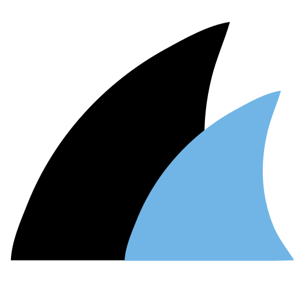
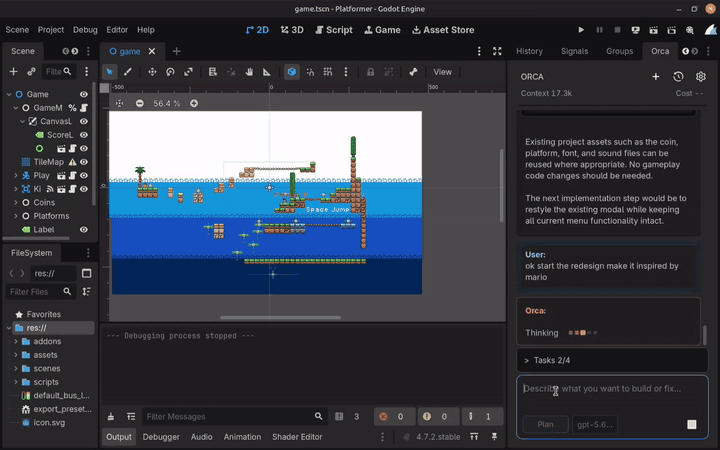

# Orca

**The open-source AI development agent that feels at home in Godot.**

Inspect your project, understand editor context, propose Godot-aware changes, and run focused development workflows without giving up control of your files.

  
  
  

<a href="https://github.com/cold-atom/Orca/releases"><b>Download</b></a> &nbsp;|&nbsp;
<a href="#install">Install</a> &nbsp;|&nbsp;
<a href="#why-orca">Why Orca</a> &nbsp;|&nbsp;
<a href="#local-models">Local Models</a> &nbsp;|&nbsp;
<a href="#demo">Demo</a> &nbsp;|&nbsp;
<a href="CONTRIBUTING.md">Contribute</a>

  

<em>Move from read-only planning to reviewed implementation without losing control of the workflow. Click the animation to open the full-resolution video.</em>

Orca is an MIT-licensed AI agent built directly into the Godot editor. It combines project exploration, editor awareness, Godot-specific tools, reviewed changes, and bounded runtime workflows in one native editor dock.

Connect an **Orca Cloud account**, bring your own provider API key, or use a local model through **Ollama**, **LM Studio**, or another OpenAI-compatible server. Orca keeps the workflow visible: it shows what it is inspecting, validates supported edits, and applies changes under your chosen edit permissions.

> Orca is not a general chatbot placed beside Godot. It is a Godot development tool designed around scenes, scripts, resources, project settings, editor state, and safe project changes.

## Why Orca?

### Designed for Godot

Orca runs as a Godot `EditorPlugin` inside the editor. It can inspect the active scene, selected nodes, scripts, project settings, resources, dependencies, and diagnostics, then open relevant files and Godot Help topics where you work.

### A controlled development workflow

- **Plan mode** is read-only. **Work mode** defaults to reviewed changes with Apply and Reject decisions.
- Proposals are validated and checked for stale or unsaved files before application. Applied changes can be reverted when the current project state still matches.
- For Godot project edits, optional Auto apply covers only explicitly authorized, bounded script changes. Scene and configuration changes retain review.
- Run a saved scene in a bounded Orca-owned process and inspect captured diagnostics without handing Orca arbitrary commands or process IDs.

### Use the providers that suit your workflow

Connect Orca Cloud, a hosted provider, or a compatible local model server. See [supported providers](#supported-providers) and the [provider setup guide](addons/orca/README.md).

### More Godot workflows

- Attach screenshots and reference images, or include explicit GDScript references with a prompt.
- Inspect scene structure, animation data, APIs, project settings, and resource dependencies.
- Create and review Blender assets through the optional [Blender Asset Studio](docs/BLENDER.md).
- Browse prior project conversations and maintain a checklist for multi-step work.

## Demo

Watch Orca explore a Godot project, propose changes, and help validate the result.

## Install

1. Download the latest Orca archive from [GitHub Releases](https://github.com/cold-atom/Orca/releases/latest).
2. Extract its `addons/orca/` directory into your Godot project's `addons/` directory.
3. Open the project in **Godot 4.7.2** and enable **Orca** in **Project > Project Settings > Plugins**.
4. Open the Orca dock, connect an Orca Cloud account or configure a provider, then send a prompt.

For provider setup and detailed workflows, see the [add-on guide](addons/orca/README.md).

## Supported Providers

- Orca Cloud (managed account access)
- OpenAI
- Google Gemini
- xAI
- DeepSeek
- Qwen / Alibaba Cloud Model Studio
- Anthropic / Claude native Messages API
- OpenRouter
- Microsoft Foundry / Azure
- Ollama
- LM Studio
- Local OpenAI-compatible servers
- Custom OpenAI-compatible endpoints

Provider capabilities, including image input and Agent tools, vary by profile. See the [provider setup guide](addons/orca/README.md) for configuration and compatibility details.

## Local Models

Orca can connect to local models served by **Ollama**, **LM Studio**, or another OpenAI-compatible server. Start the server, select the matching profile in Orca's Provider settings, then discover or enter a model ID. No API key is needed when your local server does not require one.

| Profile | Conventional endpoint | Model discovery | API key |
| --- | --- | --- | --- |
| Ollama | `http://127.0.0.1:11434/v1` | Native Ollama tags | Optional |
| LM Studio | `http://127.0.0.1:1234/v1` | Native LM Studio models | Optional |
| Local OpenAI-compatible | Your local `/v1` base URL | Compatible model list | Optional |

Local and editable profiles begin in Chat mode. To enable Agent tools, run **Test & Enable Agent tools** for the exact provider, endpoint, and model configuration. This bounded compatibility check does not guarantee that a model will use tools reliably on real tasks. See [local provider setup](addons/orca/README.md#providers-and-data).

## How Safety Works

- Plan mode does not expose project mutation or game-process operations.
- Work mode starts with reviewed changes. Every change still passes runtime permission, path, conflict, and validation checks.
- Project access is confined to `res://`; symbolic links and Orca's own add-on directory are protected.
- Known unsaved scripts and scenes are not overwritten by disk proposals.
- Tool calls, searches, reads, network waits, and Orca-owned game processes are bounded.

Orca complements source control, code review, backups, and project testing; it does not replace them. See the full [security model](SECURITY.md).

## Data And Privacy

Prompts, attached images, relevant editor context, and project content returned by Orca's tools may be sent to the selected provider. Project conversation history, including submitted images and script references, is stored locally as plaintext JSON. BYOK keys are saved in Godot Editor Settings; Orca Cloud refresh credentials use the OS credential vault, while access tokens stay in memory. Review [Security](SECURITY.md) for storage and endpoint details.

## Documentation

- [Provider setup and add-on guide](addons/orca/README.md)
- [Blender workflows](docs/BLENDER.md) · [Extensions](docs/EXTENSIONS.md)
- [Localization](docs/LOCALIZATION.md) · [Updates and releases](docs/UPDATES.md)
- [Changelog](CHANGELOG.md)
- [Security and privacy](SECURITY.md)
- [Development and architecture](DEVELOPMENT.md) · [Test guide](tests/README.md)

## Compatibility And Scope

Orca currently targets **Godot 4.7.2**. Provider support and model quality vary; synthetic compatibility checks confirm a narrow protocol exchange, not general task quality. Runtime verification is bounded and cannot prove visual or gameplay correctness.

## Contributing

Contributions are welcome. Start with [CONTRIBUTING.md](CONTRIBUTING.md), report bugs or request features through [GitHub Issues](https://github.com/cold-atom/Orca/issues/new/choose), and use [Discussions](https://github.com/cold-atom/Orca/discussions) for questions and early ideas.

## License

Orca is open-source software released under the [MIT License](LICENSE).
